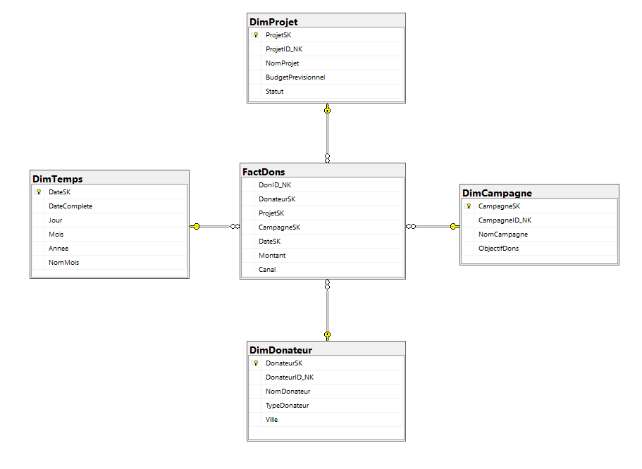
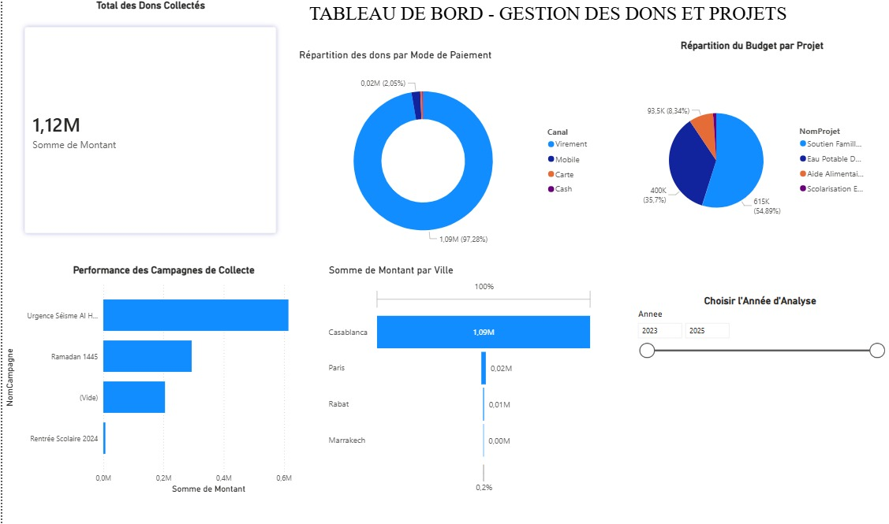

# 📊 Business Intelligence — Gestion des Dons et Projets Associatifs

## 📌 Présentation du projet

Ce projet consiste à concevoir et mettre en place une solution de **Business Intelligence (BI)** destinée à une association caritative afin de faciliter le suivi et l'analyse des dons, des campagnes et des projets associatifs.

La solution repose sur la construction d'un Data Warehouse, l'intégration des données via des processus ETL et la création d'un tableau de bord interactif pour l'aide à la décision.

## 🎯 Objectifs

- Centraliser les données relatives aux dons, campagnes et projets.
- Concevoir un Data Warehouse avec un modèle dimensionnel.
- Automatiser l'intégration des données à travers des processus ETL.
- Visualiser les indicateurs clés de performance (KPI).
- Faciliter l'analyse et la prise de décision.

## 🛠️ Technologies utilisées

- **SQL Server** — Gestion et stockage des données.
- **SSIS (SQL Server Integration Services)** — Processus ETL.
- **Power BI** — Visualisation et analyse des données.
- **SQL** — Création et manipulation du Data Warehouse.
- **Visual Studio / SSDT** — Développement des packages SSIS.

## 🏗️ Architecture de la solution

Le projet suit une architecture décisionnelle :

**Sources de données → ETL (SSIS) → Data Warehouse (SQL Server) → Power BI**

### Modélisation du Data Warehouse

Le Data Warehouse repose sur une modélisation dimensionnelle permettant l'analyse des activités de l'association.

## 🔄 Processus ETL

Les processus ETL développés avec SSIS permettent de préparer et d'intégrer les données dans le Data Warehouse.

Les principaux packages sont :

- `Pkg_LoadDimensions.dtsx` : chargement des dimensions.
- `Pkg_LoadFact.dtsx` : chargement des faits.

## 📊 Tableau de bord Power BI

Un tableau de bord interactif a été développé pour explorer les données et suivre les activités de l'association.

Le fichier Power BI est disponible dans le dépôt :

`04_Dashboard_Association.pbix`

### 📊 Aperçu du Dashboard

## 📁 Fichiers du projet

| Fichier | Description |
|---|---|
| `Schema.png` | Schéma du Data Warehouse |
| `02_Script_DW_create.sql` | Script SQL de création du Data Warehouse |
| `Pkg_LoadDimensions.dtsx` | Package SSIS de chargement des dimensions |
| `Pkg_LoadFact.dtsx` | Package SSIS de chargement des faits |
| `SSIS_Projet10_Association.ispac` | Projet SSIS déployable |
| `04_Dashboard_Association.pbix` | Tableau de bord Power BI |
| `05_Rapport.pdf` | Rapport détaillé du projet |

## 📄 Documentation

Le rapport complet présente la conception, la modélisation, les processus ETL et la réalisation du tableau de bord.

📘 [Consulter le rapport du projet](05_Rapport.pdf)

## 🎓 Contexte

Projet académique réalisé dans le cadre de la formation en **Génie Informatique à l'ENSA Berrechid**.

**Domaine :** Business Intelligence, Data Engineering et Data Analytics.
